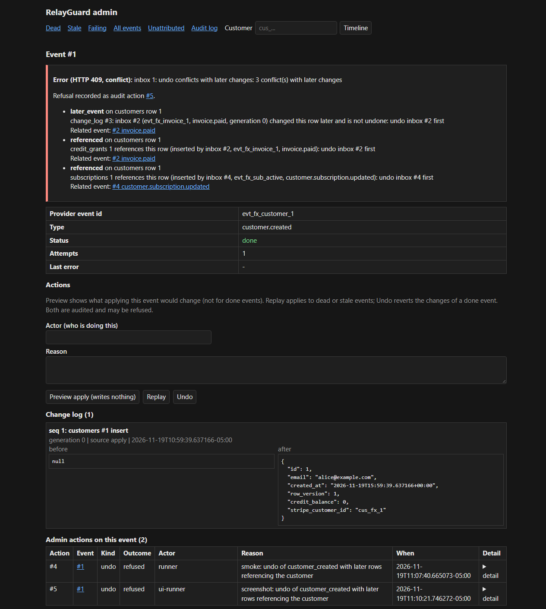
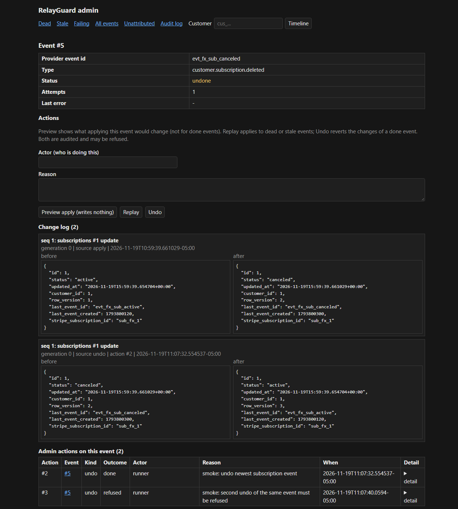
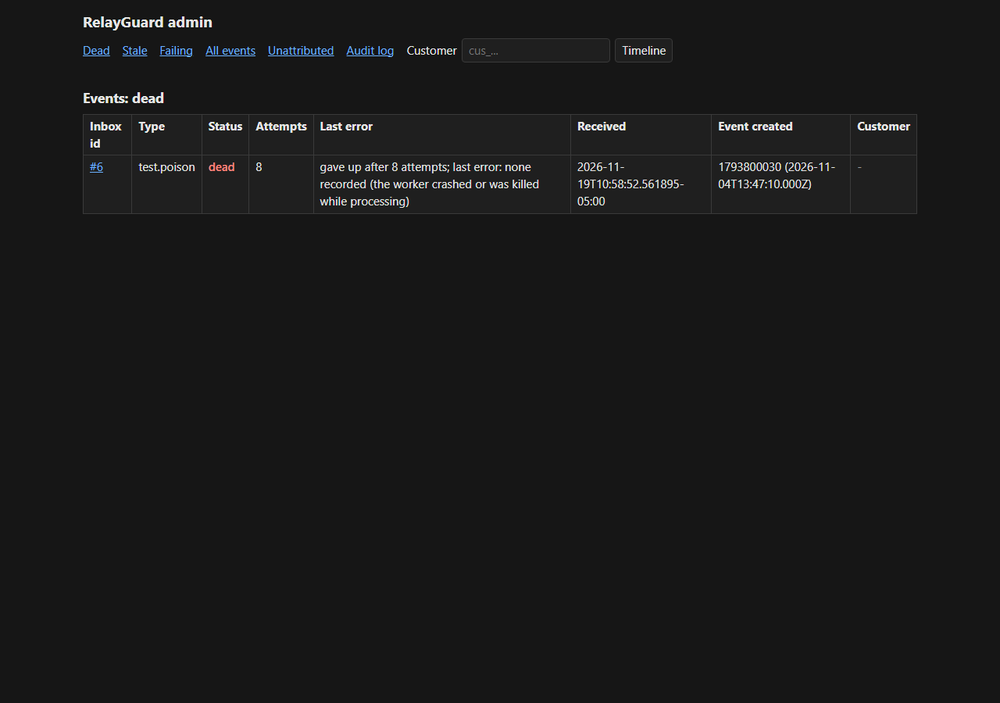

# RelayGuard

Crash-safe processing for inbound webhooks: each event's effect is applied exactly once,
even through crashes, duplicates, and out-of-order delivery.

> Status: phases 1-7 done (naive baseline, inbox + transactional worker, ordering, chaos harness with crashes,
> lease + dead-lettering, audited replay/undo, local admin dashboard). Measured results, each with date, command
> and commit: docs/phase2-results.md to docs/phase7-results.md (phase 1 has no results file).

## Quick start (Windows PowerShell)

```powershell
Copy-Item .env.example .env
.\dev.ps1 up          # start Postgres in Docker
.\dev.ps1 receiver    # terminal 1
.\dev.ps1 listen      # terminal 2 (copy the whsec_ secret into .env)
.\dev.ps1 trigger     # terminal 3: send a test event
```

On macOS/Linux the same commands work directly: `docker compose up -d`, `go run ./cmd/receiver`, and so on.

## Admin dashboard (Phase 7)

`admin serve` runs a local dashboard over the same audited code the `admin` CLI uses. It lists events by status
(dead, stale, failing, all), shows a customer's timeline, events whose payload could not be attributed to a
customer ("unattributed"), and the audit log. The event page shows the change history and offers Preview (writes
nothing), Replay and Undo; replay and undo require an actor and a reason every time and are audited, including refusals.

```powershell
powershell.exe -NoProfile -ExecutionPolicy Bypass -File dev.ps1 build
bin\admin.exe serve          # run from the repo root; DATABASE_URL comes from the environment or .env; optional flag: -addr 127.0.0.1:8090 (the default)
```

Then open http://127.0.0.1:8090/. The only accepted address form is `127.0.0.1:<port>`.



Fixture data from testdata/events, 2026-11-19, 0b42f07. Undo of an event whose customer has later changes is refused and lists the conflicts.



Fixture data from testdata/events, 2026-11-19, 0b42f07. An event after a successful undo.



Fixture data from testdata/events, 2026-11-19, 0b42f07. The dead list (the poison event).

Safety: there is no login. The server binds only to loopback and defends against hostile web pages in your own
browser (Host allow-list, cross-origin protection, JSON-only POSTs); see
[docs/decisions/0006-dashboard-localhost-security.md](docs/decisions/0006-dashboard-localhost-security.md).
Evidence and limits: [docs/phase7-results.md](docs/phase7-results.md).

## Layout

- `cmd/` runnable programs (receiver, worker, naive baseline, chaos harness, admin CLI and dashboard server)
- `internal/` application code
- `migrations/` SQL schema changes
- `docs/decisions/` short notes on design decisions
- `internal/adminhttp/` dashboard API and the embedded UI (plain HTML/CSS/JS, no build step)
