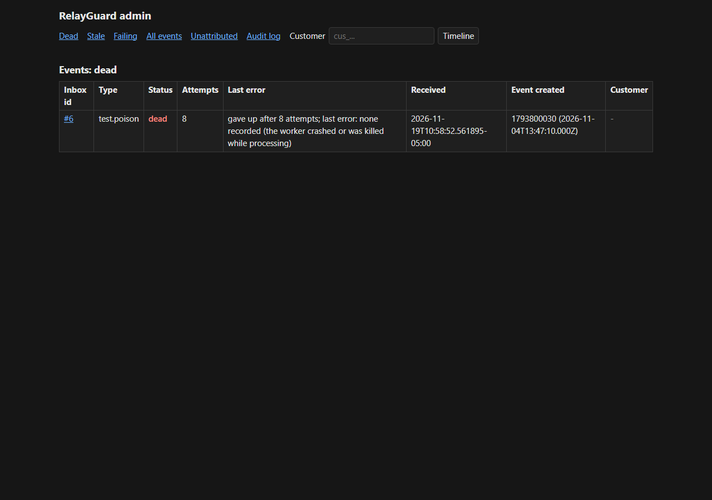
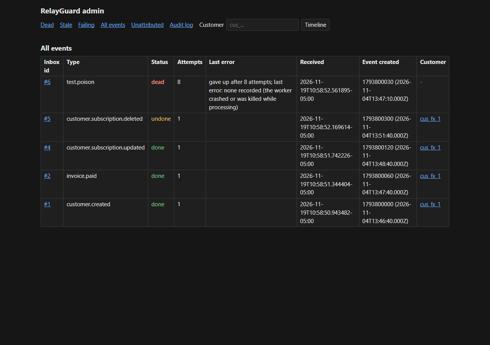
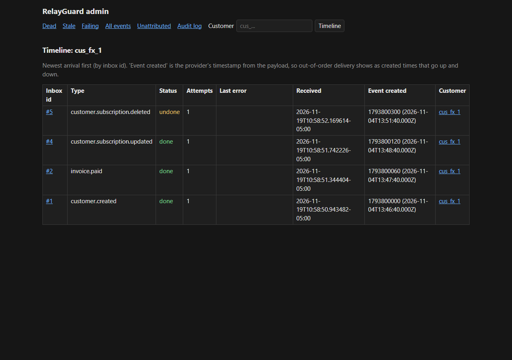
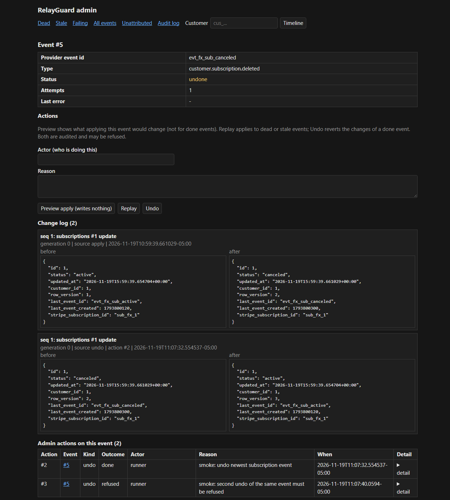
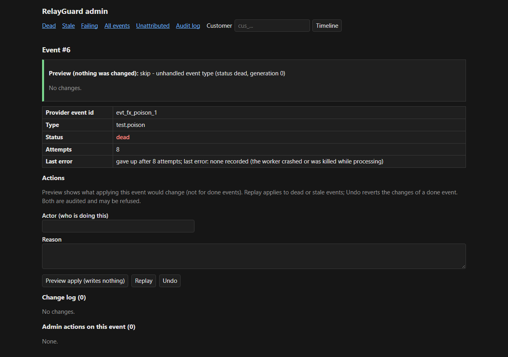
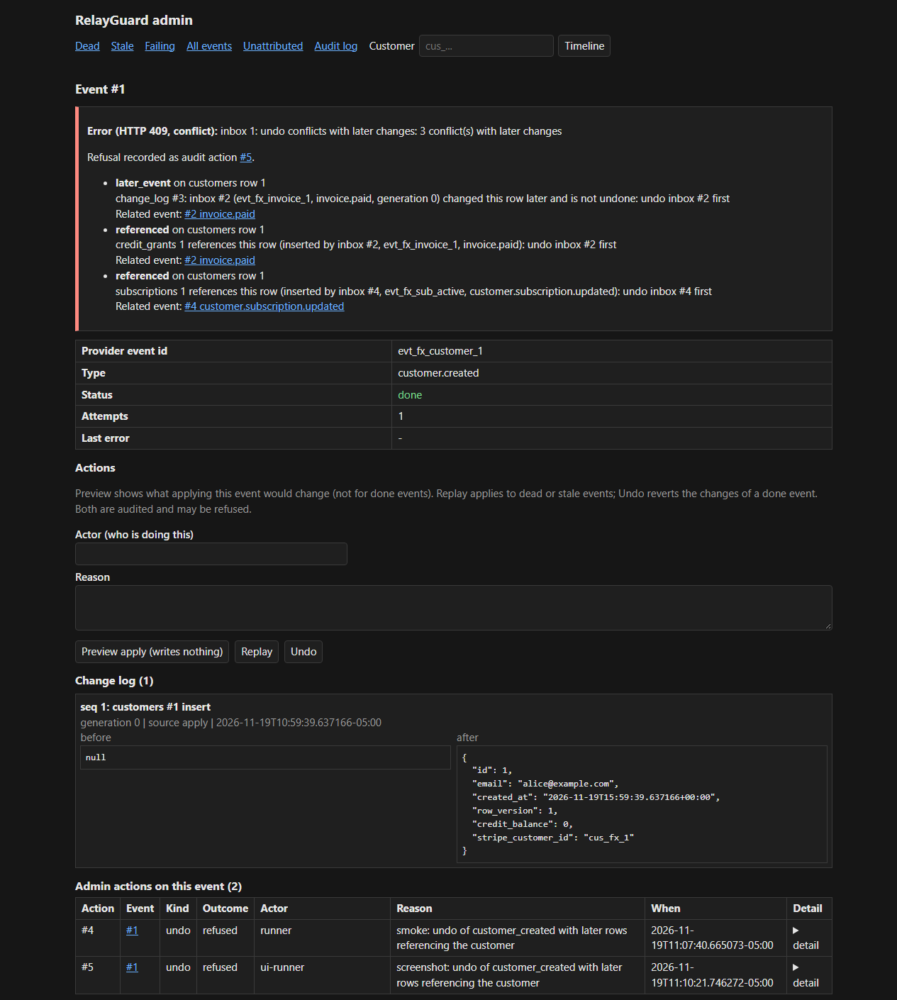
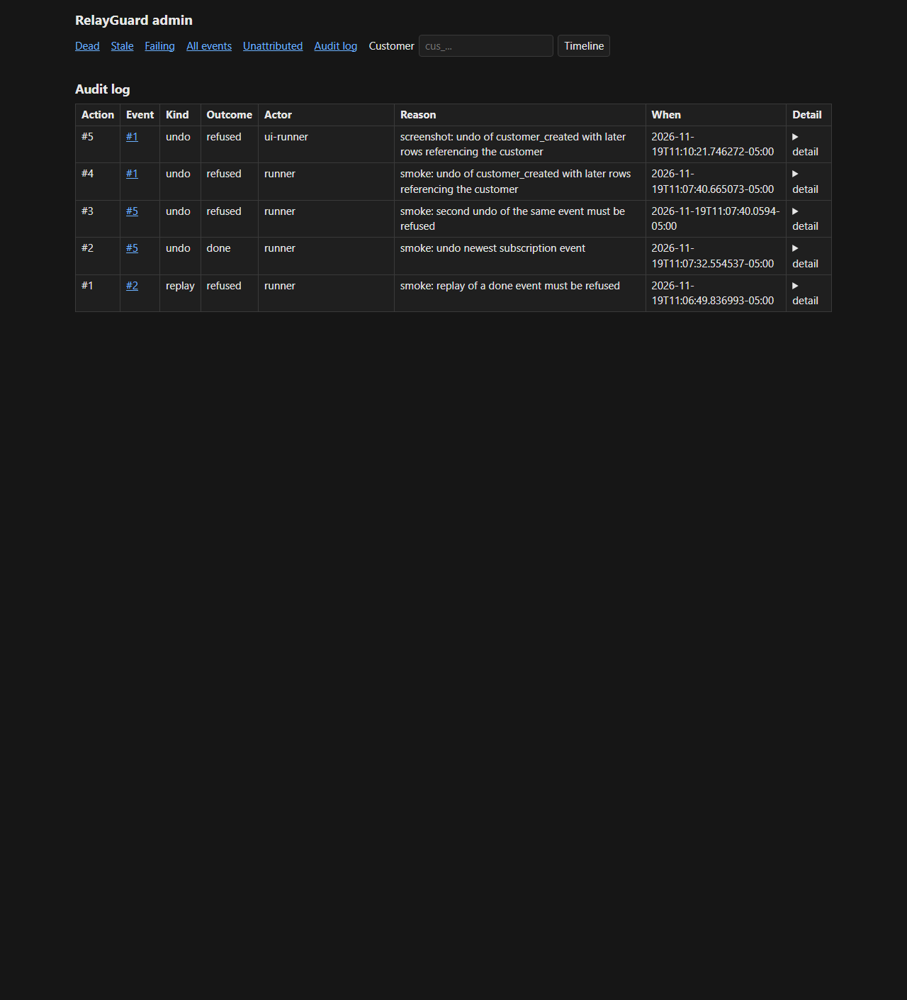

# Phase 7 dashboard smoke (admin API transcript)

Date: 2026-11-19. Git commit: 0b42f07aa514e740e56a4f7e9b8d3823dd4c3880 (tree clean at build time, see the vcs lines below).
Data: synthetic fixtures from testdata/events (not real Stripe events). Single dev database, reset with `dev.ps1 reset-data` before the run.
All responses below are pasted verbatim from files written by the run. The HTTP calls use curl.exe, not Invoke-RestMethod
(deviation from the plan: Windows PowerShell 5.1 Invoke-RestMethod throws on 4xx, which would hide the 409 bodies).
Commands that contain a `?` or a JSON body were run with shell quoting around the URL/body; the `$ curl.exe ...` line is a
transcript header written by the run's helper function, not a copy-paste shell line. Ids come from the list responses (ids 1, 2, 4, 5, 6;
id 3 was the deduplicated second delivery of invoice_paid and consumed a sequence value only).

## Build provenance

Commands: `dev.ps1 build` (bin/admin.exe, bin/worker.exe), `go build -o <scratchpad>/receiver.exe ./cmd/receiver`; then `go version -m <exe> | grep vcs`.

```text
== bin/admin.exe
	build	vcs=git
	build	vcs.revision=0b42f07aa514e740e56a4f7e9b8d3823dd4c3880
	build	vcs.time=2026-11-19T15:53:18Z
	build	vcs.modified=false
== bin/worker.exe
	build	vcs=git
	build	vcs.revision=0b42f07aa514e740e56a4f7e9b8d3823dd4c3880
	build	vcs.time=2026-11-19T15:53:18Z
	build	vcs.modified=false
== <scratchpad>/receiver.exe
	build	vcs=git
	build	vcs.revision=0b42f07aa514e740e56a4f7e9b8d3823dd4c3880
	build	vcs.time=2026-11-19T15:53:18Z
	build	vcs.modified=false
```

## Setup: send fixtures

Commands (from C:\dev\relayguard, receiver running, after reset-data): `dev.ps1 send testdata/events/<name>.json [n]` for customer_created,
invoice_paid (n=2), subscription_active, subscription_canceled, poison. Receiver startup line: "RelayGuard receiver listening on 127.0.0.1:8080".

### send output

```text
== send customer_created
attempt 1 -> HTTP 200
== send invoice_paid 2
attempt 1 -> HTTP 200
attempt 2 -> HTTP 200
== send subscription_active
attempt 1 -> HTTP 200
== send subscription_canceled
attempt 1 -> HTTP 200
== send poison
attempt 1 -> HTTP 200
```

### dev.ps1 inbox after sending, before the worker ran (note: id 3 is absent, the duplicate invoice_paid was deduplicated)

```text
 id |      event_id       |          event_type           | status  | attempts | last_error 
----+---------------------+-------------------------------+---------+----------+------------
  1 | evt_fx_customer_1   | customer.created              | pending |        0 | 
  2 | evt_fx_invoice_1    | invoice.paid                  | pending |        0 | 
  4 | evt_fx_sub_active   | customer.subscription.updated | pending |        0 | 
  5 | evt_fx_sub_canceled | customer.subscription.deleted | pending |        0 | 
  6 | evt_fx_poison_1     | test.poison                   | pending |        0 | 
(5 rows)

```

## Worker run to dead

Command: `bin/worker.exe` with env FAULT_POISON=1 and WORKER_LEASE=1s, restarted by a PowerShell loop (scratchpad script, not in the repo)
whenever the process exited, polling the database every 200 ms for `status='dead'`. Worker start times are seconds since the loop's stopwatch
started. Core of the loop, verbatim (scratchpad path elided as `$sp`; post-loop logging omitted):

```powershell
$env:FAULT_POISON = '1'; $env:WORKER_LEASE = '1s'
$sw = [Diagnostics.Stopwatch]::StartNew()
$starts = 0; $p = $null
while ($true) {
  if ($p -eq $null -or $p.HasExited) {
    $starts++
    $p = Start-Process -FilePath 'bin\worker.exe' -RedirectStandardError "$sp\w_$starts.err" -RedirectStandardOutput "$sp\w_$starts.out" -WindowStyle Hidden -PassThru
    "$($sw.Elapsed.TotalSeconds) start #$starts pid $($p.Id)" | Out-File -Append -Encoding ascii "$sp\worker.log"
  }
  $dead = (docker exec relayguard-db-1 psql -U relayguard -d relayguard -tA -c "select count(*) from inbox where status='dead'") 2>$null
  if ($dead -match '^1$') { break }
  if ($sw.Elapsed.TotalSeconds -gt 300) { "TIMEOUT" | Out-File -Append "$sp\worker.log"; break }
  Start-Sleep -Milliseconds 200
}
$sw.Stop()
```

### worker restart log (measured)

```text
1.286156 start #1 pid 4048
1.621216 start #2 pid 14816
2.8761067 start #3 pid 38276
4.1205373 start #4 pid 31264
5.3873087 start #5 pid 35220
6.6735771 start #6 pid 21708
7.9446448 start #7 pid 15696
9.2011105 start #8 pid 10144
10.4526645 start #9 pid 17496
dead observed after 11.7971117 s wall, 9 worker starts; began 11/19/2026 10:59:38
stopped last pid 17496
```

Last worker stderr lines (from the per-start stderr files):

```text
2026/11/19 10:59:47 POISON: evt_fx_poison_1 crashes the worker (attempt 7)
2026/11/19 10:59:48 POISON: evt_fx_poison_1 crashes the worker (attempt 8)
2026/11/19 10:59:49 DEAD inbox row 6 after 8 attempts (possible poison event)
```

### dev.ps1 inbox after worker (receiver and worker stopped by PID)

```text
 id |      event_id       |          event_type           | status | attempts |                               last_error                               
----+---------------------+-------------------------------+--------+----------+------------------------------------------------------------------------
  1 | evt_fx_customer_1   | customer.created              | done   |        1 | 
  2 | evt_fx_invoice_1    | invoice.paid                  | done   |        1 | 
  4 | evt_fx_sub_active   | customer.subscription.updated | done   |        1 | 
  5 | evt_fx_sub_canceled | customer.subscription.deleted | done   |        1 | 
  6 | evt_fx_poison_1     | test.poison                   | dead   |        8 | gave up after 8 attempts; last error: none recorded (the worker crashe
(5 rows)

```

### dev.ps1 state after worker

```text
 stripe_customer_id | credit_balance | grants | ledger_total 
--------------------+----------------+--------+--------------
 cus_fx_1           |             20 |      1 |           20
(1 row)

 stripe_subscription_id |  status  |    last_event_id    | last_event_created 
------------------------+----------+---------------------+--------------------
 sub_fx_1               | canceled | evt_fx_sub_canceled |         1793800300
(1 row)

```

## admin serve transcript

`bin/admin.exe serve` (default 127.0.0.1:8090). Startup line: "admin: dashboard API listening on http://127.0.0.1:8090 (no authentication; loopback only)".

### 1. GET dead events

```text
$ curl.exe -s -w "\nHTTP %{http_code}\n" http://127.0.0.1:8090/api/events?status=dead
{"events":[{"id":6,"event_id":"evt_fx_poison_1","event_type":"test.poison","status":"dead","attempts":8,"last_error":"gave up after 8 attempts; last error: none recorded (the worker crashed or was killed while processing)","received_at":"2026-11-19T10:58:52.561895-05:00","event_created":1793800030,"customer_id":""}],"next_before":0}

HTTP 200
```

### 2. GET all events

```text
$ curl.exe -s -w "\nHTTP %{http_code}\n" http://127.0.0.1:8090/api/events
{"events":[{"id":6,"event_id":"evt_fx_poison_1","event_type":"test.poison","status":"dead","attempts":8,"last_error":"gave up after 8 attempts; last error: none recorded (the worker crashed or was killed while processing)","received_at":"2026-11-19T10:58:52.561895-05:00","event_created":1793800030,"customer_id":""},{"id":5,"event_id":"evt_fx_sub_canceled","event_type":"customer.subscription.deleted","status":"done","attempts":1,"last_error":"","received_at":"2026-11-19T10:58:52.169614-05:00","event_created":1793800300,"customer_id":"cus_fx_1"},{"id":4,"event_id":"evt_fx_sub_active","event_type":"customer.subscription.updated","status":"done","attempts":1,"last_error":"","received_at":"2026-11-19T10:58:51.742226-05:00","event_created":1793800120,"customer_id":"cus_fx_1"},{"id":2,"event_id":"evt_fx_invoice_1","event_type":"invoice.paid","status":"done","attempts":1,"last_error":"","received_at":"2026-11-19T10:58:51.344404-05:00","event_created":1793800060,"customer_id":"cus_fx_1"},{"id":1,"event_id":"evt_fx_customer_1","event_type":"customer.created","status":"done","attempts":1,"last_error":"","received_at":"2026-11-19T10:58:50.943482-05:00","event_created":1793800000,"customer_id":"cus_fx_1"}],"next_before":0}

HTTP 200
```

### 3. GET customer timeline

```text
$ curl.exe -s -w "\nHTTP %{http_code}\n" http://127.0.0.1:8090/api/customers/cus_fx_1/timeline
{"events":[{"id":5,"event_id":"evt_fx_sub_canceled","event_type":"customer.subscription.deleted","status":"done","attempts":1,"last_error":"","received_at":"2026-11-19T10:58:52.169614-05:00","event_created":1793800300,"customer_id":"cus_fx_1"},{"id":4,"event_id":"evt_fx_sub_active","event_type":"customer.subscription.updated","status":"done","attempts":1,"last_error":"","received_at":"2026-11-19T10:58:51.742226-05:00","event_created":1793800120,"customer_id":"cus_fx_1"},{"id":2,"event_id":"evt_fx_invoice_1","event_type":"invoice.paid","status":"done","attempts":1,"last_error":"","received_at":"2026-11-19T10:58:51.344404-05:00","event_created":1793800060,"customer_id":"cus_fx_1"},{"id":1,"event_id":"evt_fx_customer_1","event_type":"customer.created","status":"done","attempts":1,"last_error":"","received_at":"2026-11-19T10:58:50.943482-05:00","event_created":1793800000,"customer_id":"cus_fx_1"}],"next_before":0}

HTTP 200
```

### 4. GET unattributed events

```text
$ curl.exe -s -w "\nHTTP %{http_code}\n" http://127.0.0.1:8090/api/events/unattributed
{"events":[{"id":6,"event_id":"evt_fx_poison_1","event_type":"test.poison","status":"dead","attempts":8,"last_error":"gave up after 8 attempts; last error: none recorded (the worker crashed or was killed while processing)","received_at":"2026-11-19T10:58:52.561895-05:00","event_created":1793800030,"customer_id":""}],"next_before":0}

HTTP 200
```

### 5. GET audit actions (empty before any action)

```text
$ curl.exe -s -w "\nHTTP %{http_code}\n" http://127.0.0.1:8090/api/actions
{"actions":[],"next_before":0}

HTTP 200
```

### 6. POST preview of the dead poison event (writes nothing, not audited)

```text
$ curl.exe -s -w "\nHTTP %{http_code}\n" -X POST -H "Content-Type: application/json" -d '{}' http://127.0.0.1:8090/api/events/6/preview
{"inbox_id":6,"event_id":"evt_fx_poison_1","event_type":"test.poison","status":"dead","attempts":8,"generation":0,"outcome":"skip","reason":"unhandled event type","changes":[]}

HTTP 200
```

### 6 cross-check: admin log 6 and state

```text
$ bin/admin.exe log 6
LOG inbox 6 (evt_fx_poison_1, test.poison): status dead, attempts 8
last_error: gave up after 8 attempts; last error: none recorded (the worker crashed or was killed while processing)
change_log: 0 row(s)
admin_actions: 0 row(s)

$ dev.ps1 state
 stripe_customer_id | credit_balance | grants | ledger_total 
--------------------+----------------+--------+--------------
 cus_fx_1           |             20 |      1 |           20
(1 row)

 stripe_subscription_id |  status  |    last_event_id    | last_event_created 
------------------------+----------+---------------------+--------------------
 sub_fx_1               | canceled | evt_fx_sub_canceled |         1793800300
(1 row)

```

### 7. POST replay of a done event (expected: refused, 409, audited)

```text
$ curl.exe -s -w "\nHTTP %{http_code}\n" -X POST -H "Content-Type: application/json" -d '{"actor":"runner","reason":"smoke: replay of a done event must be refused"}' http://127.0.0.1:8090/api/events/2/replay
{"error":"not_replayable","message":"inbox 2: event cannot be replayed: status done is not replayable (only dead and stale)","result":{"inbox_id":2,"event_id":"evt_fx_invoice_1","event_type":"invoice.paid","outcome":"refused","reason":"status done is not replayable (only dead and stale)","action_id":1,"from_status":"done","from_attempts":1,"from_last_error":"","from_processed_at":"2026-11-19T10:59:39.645309-05:00","generation":0}}

HTTP 409
```

### 7 cross-check: admin log 2 and state

```text
$ bin/admin.exe log 2
LOG inbox 2 (evt_fx_invoice_1, invoice.paid): status done, attempts 1
change_log: 2 row(s)
  #2 2026-11-19 15:59:39Z gen 0 apply seq 1: insert credit_grants 1: amount (none) -> 20, created_at (none) -> "2026-11-19T15:59:39.645309+00:00", customer_id (none) -> 1, id (none) -> 1, row_version (none) -> 1, stripe_invoice_id (none) -> "in_fx_1"
  #3 2026-11-19 15:59:39Z gen 0 apply seq 2: update customers 1: credit_balance 0 -> 20, row_version 1 -> 2
admin_actions: 1 row(s)
  #1 2026-11-19 16:06:49Z replay refused by runner, reason "smoke: replay of a done event must be refused", detail {"status": "done", "refused": "status done is not replayable (only dead and stale)", "attempts": 1, "generation": 0}

$ dev.ps1 state
 stripe_customer_id | credit_balance | grants | ledger_total 
--------------------+----------------+--------+--------------
 cus_fx_1           |             20 |      1 |           20
(1 row)

 stripe_subscription_id |  status  |    last_event_id    | last_event_created 
------------------------+----------+---------------------+--------------------
 sub_fx_1               | canceled | evt_fx_sub_canceled |         1793800300
(1 row)

```

### 8. POST undo of the newest subscription event, inbox 5 (expected: 200 done)

```text
$ curl.exe -s -w "\nHTTP %{http_code}\n" -X POST -H "Content-Type: application/json" -d '{"actor":"runner","reason":"smoke: undo newest subscription event"}' http://127.0.0.1:8090/api/events/5/undo
{"inbox_id":5,"event_id":"evt_fx_sub_canceled","event_type":"customer.subscription.deleted","status":"done","generation":0,"outcome":"done","reason":"","action_id":2,"changes":[{"table":"subscriptions","row_id":1,"op":"update","before":{"id":1,"status":"canceled","updated_at":"2026-11-19T15:59:39.661029+00:00","customer_id":1,"row_version":2,"last_event_id":"evt_fx_sub_canceled","last_event_created":1793800300,"stripe_subscription_id":"sub_fx_1"},"after":{"id":1,"status":"active","updated_at":"2026-11-19T15:59:39.654704+00:00","customer_id":1,"row_version":3,"last_event_id":"evt_fx_sub_active","last_event_created":1793800120,"stripe_subscription_id":"sub_fx_1"}}],"conflicts":[],"warnings":[]}

HTTP 200
```

### 8 cross-check: admin log 5 and state (subscription back to active)

```text
$ bin/admin.exe log 5
LOG inbox 5 (evt_fx_sub_canceled, customer.subscription.deleted): status undone, attempts 1
change_log: 2 row(s)
  #5 2026-11-19 15:59:39Z gen 0 apply seq 1: update subscriptions 1: last_event_created 1793800120 -> 1793800300, last_event_id "evt_fx_sub_active" -> "evt_fx_sub_canceled", row_version 1 -> 2, status "active" -> "canceled", updated_at "2026-11-19T15:59:39.654704+00:00" -> "2026-11-19T15:59:39.661029+00:00"
  #6 2026-11-19 16:07:32Z gen 0 undo (action 2) seq 1: update subscriptions 1: last_event_created 1793800300 -> 1793800120, last_event_id "evt_fx_sub_canceled" -> "evt_fx_sub_active", row_version 2 -> 3, status "canceled" -> "active", updated_at "2026-11-19T15:59:39.661029+00:00" -> "2026-11-19T15:59:39.654704+00:00"
admin_actions: 1 row(s)
  #2 2026-11-19 16:07:32Z undo done by runner, reason "smoke: undo newest subscription event", detail {"changes": 1, "generation": 0, "from_status": "done"}

$ dev.ps1 state
 stripe_customer_id | credit_balance | grants | ledger_total 
--------------------+----------------+--------+--------------
 cus_fx_1           |             20 |      1 |           20
(1 row)

 stripe_subscription_id | status |   last_event_id   | last_event_created 
------------------------+--------+-------------------+--------------------
 sub_fx_1               | active | evt_fx_sub_active |         1793800120
(1 row)

```

### 9. POST undo of inbox 5 again (expected: refused, 409)

```text
$ curl.exe -s -w "\nHTTP %{http_code}\n" -X POST -H "Content-Type: application/json" -d '{"actor":"runner","reason":"smoke: second undo of the same event must be refused"}' http://127.0.0.1:8090/api/events/5/undo
{"error":"not_undoable","message":"inbox 5: event cannot be undone: the event was already undone (admin action #2)","result":{"inbox_id":5,"event_id":"evt_fx_sub_canceled","event_type":"customer.subscription.deleted","status":"undone","generation":0,"outcome":"refused","reason":"the event was already undone (admin action #2)","action_id":3,"changes":[],"conflicts":[],"warnings":[]}}

HTTP 409
```

### 9 cross-check: admin log 5 and state

```text
$ bin/admin.exe log 5
LOG inbox 5 (evt_fx_sub_canceled, customer.subscription.deleted): status undone, attempts 1
change_log: 2 row(s)
  #5 2026-11-19 15:59:39Z gen 0 apply seq 1: update subscriptions 1: last_event_created 1793800120 -> 1793800300, last_event_id "evt_fx_sub_active" -> "evt_fx_sub_canceled", row_version 1 -> 2, status "active" -> "canceled", updated_at "2026-11-19T15:59:39.654704+00:00" -> "2026-11-19T15:59:39.661029+00:00"
  #6 2026-11-19 16:07:32Z gen 0 undo (action 2) seq 1: update subscriptions 1: last_event_created 1793800300 -> 1793800120, last_event_id "evt_fx_sub_canceled" -> "evt_fx_sub_active", row_version 2 -> 3, status "canceled" -> "active", updated_at "2026-11-19T15:59:39.661029+00:00" -> "2026-11-19T15:59:39.654704+00:00"
admin_actions: 2 row(s)
  #2 2026-11-19 16:07:32Z undo done by runner, reason "smoke: undo newest subscription event", detail {"changes": 1, "generation": 0, "from_status": "done"}
  #3 2026-11-19 16:07:40Z undo refused by runner, reason "smoke: second undo of the same event must be refused", detail {"status": "undone", "refused": "the event was already undone (admin action #2)", "conflicts": [], "generation": 0}

$ dev.ps1 state
 stripe_customer_id | credit_balance | grants | ledger_total 
--------------------+----------------+--------+--------------
 cus_fx_1           |             20 |      1 |           20
(1 row)

 stripe_subscription_id | status |   last_event_id   | last_event_created 
------------------------+--------+-------------------+--------------------
 sub_fx_1               | active | evt_fx_sub_active |         1793800120
(1 row)

```

### 10. POST undo of customer_created, inbox 1 (expected: 409 conflict)

```text
$ curl.exe -s -w "\nHTTP %{http_code}\n" -X POST -H "Content-Type: application/json" -d '{"actor":"runner","reason":"smoke: undo of customer_created with later rows referencing the customer"}' http://127.0.0.1:8090/api/events/1/undo
{"error":"conflict","message":"inbox 1: undo conflicts with later changes: 3 conflict(s) with later changes","result":{"inbox_id":1,"event_id":"evt_fx_customer_1","event_type":"customer.created","status":"done","generation":0,"outcome":"refused","reason":"3 conflict(s) with later changes","action_id":4,"changes":[],"conflicts":[{"kind":"later_event","table":"customers","row_id":1,"change_log_id":3,"inbox_id":2,"event_id":"evt_fx_invoice_1","event_type":"invoice.paid","generation":0,"explanation":"change_log #3: inbox #2 (evt_fx_invoice_1, invoice.paid, generation 0) changed this row later and is not undone: undo inbox #2 first"},{"kind":"referenced","table":"customers","row_id":1,"change_log_id":2,"inbox_id":2,"event_id":"evt_fx_invoice_1","event_type":"invoice.paid","generation":0,"explanation":"credit_grants 1 references this row (inserted by inbox #2, evt_fx_invoice_1, invoice.paid): undo inbox #2 first"},{"kind":"referenced","table":"customers","row_id":1,"change_log_id":4,"inbox_id":4,"event_id":"evt_fx_sub_active","event_type":"customer.subscription.updated","generation":0,"explanation":"subscriptions 1 references this row (inserted by inbox #4, evt_fx_sub_active, customer.subscription.updated): undo inbox #4 first"}],"warnings":[]}}

HTTP 409
```

### 10 cross-check: admin log 1 and state

```text
$ bin/admin.exe log 1
LOG inbox 1 (evt_fx_customer_1, customer.created): status done, attempts 1
change_log: 1 row(s)
  #1 2026-11-19 15:59:39Z gen 0 apply seq 1: insert customers 1: created_at (none) -> "2026-11-19T15:59:39.637166+00:00", credit_balance (none) -> 0, email (none) -> "alice@example.com", id (none) -> 1, row_version (none) -> 1, stripe_customer_id (none) -> "cus_fx_1"
admin_actions: 1 row(s)
  #4 2026-11-19 16:07:40Z undo refused by runner, reason "smoke: undo of customer_created with later rows referencing the customer", detail {"status": "done", "refused": "3 conflict(s) with later changes", "conflicts": [{"kind": "later_event", "table": "customers", "row_id": 1, "event_id": "evt_fx_invoice_1", "inbox_id": 2, "event_type": "invoice.paid", "generation": 0, "explanation": "change_log #3: inbox #2 (evt_fx_invoice_1, invoice.paid, generation 0) changed this row later and is not undone: undo inbox #2 first", "change_log_id": 3}, {"kind": "referenced", "table": "customers", "row_id": 1, "event_id": "evt_fx_invoice_1", "inbox_id": 2, "event_type": "invoice.paid", "generation": 0, "explanation": "credit_grants 1 references this row (inserted by inbox #2, evt_fx_invoice_1, invoice.paid): undo inbox #2 first", "change_log_id": 2}, {"kind": "referenced", "table": "customers", "row_id": 1, "event_id": "evt_fx_sub_active", "inbox_id": 4, "event_type": "customer.subscription.updated", "generation": 0, "explanation": "subscriptions 1 references this row (inserted by inbox #4, evt_fx_sub_active, customer.subscription.updated): undo inbox #4 first", "change_log_id": 4}], "generation": 0}

$ dev.ps1 state
 stripe_customer_id | credit_balance | grants | ledger_total 
--------------------+----------------+--------+--------------
 cus_fx_1           |             20 |      1 |           20
(1 row)

 stripe_subscription_id | status |   last_event_id   | last_event_created 
------------------------+--------+-------------------+--------------------
 sub_fx_1               | active | evt_fx_sub_active |         1793800120
(1 row)

```

### 11. GET audit actions after the sequence

```text
$ curl.exe -s -w "\nHTTP %{http_code}\n" http://127.0.0.1:8090/api/actions
{"actions":[{"id":4,"inbox_id":1,"action":"undo","actor":"runner","reason":"smoke: undo of customer_created with later rows referencing the customer","outcome":"refused","detail":{"status":"done","refused":"3 conflict(s) with later changes","conflicts":[{"kind":"later_event","table":"customers","row_id":1,"event_id":"evt_fx_invoice_1","inbox_id":2,"event_type":"invoice.paid","generation":0,"explanation":"change_log #3: inbox #2 (evt_fx_invoice_1, invoice.paid, generation 0) changed this row later and is not undone: undo inbox #2 first","change_log_id":3},{"kind":"referenced","table":"customers","row_id":1,"event_id":"evt_fx_invoice_1","inbox_id":2,"event_type":"invoice.paid","generation":0,"explanation":"credit_grants 1 references this row (inserted by inbox #2, evt_fx_invoice_1, invoice.paid): undo inbox #2 first","change_log_id":2},{"kind":"referenced","table":"customers","row_id":1,"event_id":"evt_fx_sub_active","inbox_id":4,"event_type":"customer.subscription.updated","generation":0,"explanation":"subscriptions 1 references this row (inserted by inbox #4, evt_fx_sub_active, customer.subscription.updated): undo inbox #4 first","change_log_id":4}],"generation":0},"created_at":"2026-11-19T11:07:40.665073-05:00"},{"id":3,"inbox_id":5,"action":"undo","actor":"runner","reason":"smoke: second undo of the same event must be refused","outcome":"refused","detail":{"status":"undone","refused":"the event was already undone (admin action #2)","conflicts":[],"generation":0},"created_at":"2026-11-19T11:07:40.0594-05:00"},{"id":2,"inbox_id":5,"action":"undo","actor":"runner","reason":"smoke: undo newest subscription event","outcome":"done","detail":{"changes":1,"generation":0,"from_status":"done"},"created_at":"2026-11-19T11:07:32.554537-05:00"},{"id":1,"inbox_id":2,"action":"replay","actor":"runner","reason":"smoke: replay of a done event must be refused","outcome":"refused","detail":{"status":"done","refused":"status done is not replayable (only dead and stale)","attempts":1,"generation":0},"created_at":"2026-11-19T11:06:49.836993-05:00"}],"next_before":0}

HTTP 200
```

### 12. GET event 5

```text
$ curl.exe -s -w "\nHTTP %{http_code}\n" http://127.0.0.1:8090/api/events/5
{"inbox_id":5,"event_id":"evt_fx_sub_canceled","event_type":"customer.subscription.deleted","status":"undone","attempts":1,"last_error":"","changes":[{"id":5,"generation":0,"source":"apply","admin_action_id":null,"seq":1,"created_at":"2026-11-19T10:59:39.661029-05:00","table":"subscriptions","row_id":1,"op":"update","before":{"id":1,"status":"active","updated_at":"2026-11-19T15:59:39.654704+00:00","customer_id":1,"row_version":1,"last_event_id":"evt_fx_sub_active","last_event_created":1793800120,"stripe_subscription_id":"sub_fx_1"},"after":{"id":1,"status":"canceled","updated_at":"2026-11-19T15:59:39.661029+00:00","customer_id":1,"row_version":2,"last_event_id":"evt_fx_sub_canceled","last_event_created":1793800300,"stripe_subscription_id":"sub_fx_1"}},{"id":6,"generation":0,"source":"undo","admin_action_id":2,"seq":1,"created_at":"2026-11-19T11:07:32.554537-05:00","table":"subscriptions","row_id":1,"op":"update","before":{"id":1,"status":"canceled","updated_at":"2026-11-19T15:59:39.661029+00:00","customer_id":1,"row_version":2,"last_event_id":"evt_fx_sub_canceled","last_event_created":1793800300,"stripe_subscription_id":"sub_fx_1"},"after":{"id":1,"status":"active","updated_at":"2026-11-19T15:59:39.654704+00:00","customer_id":1,"row_version":3,"last_event_id":"evt_fx_sub_active","last_event_created":1793800120,"stripe_subscription_id":"sub_fx_1"}}],"actions":[{"id":2,"inbox_id":5,"action":"undo","actor":"runner","reason":"smoke: undo newest subscription event","outcome":"done","detail":{"changes":1,"generation":0,"from_status":"done"},"created_at":"2026-11-19T11:07:32.554537-05:00"},{"id":3,"inbox_id":5,"action":"undo","actor":"runner","reason":"smoke: second undo of the same event must be refused","outcome":"refused","detail":{"status":"undone","refused":"the event was already undone (admin action #2)","conflicts":[],"generation":0},"created_at":"2026-11-19T11:07:40.0594-05:00"}]}

HTTP 200
```

### 12. GET event 2

```text
$ curl.exe -s -w "\nHTTP %{http_code}\n" http://127.0.0.1:8090/api/events/2
{"inbox_id":2,"event_id":"evt_fx_invoice_1","event_type":"invoice.paid","status":"done","attempts":1,"last_error":"","changes":[{"id":2,"generation":0,"source":"apply","admin_action_id":null,"seq":1,"created_at":"2026-11-19T10:59:39.645309-05:00","table":"credit_grants","row_id":1,"op":"insert","before":null,"after":{"id":1,"amount":20,"created_at":"2026-11-19T15:59:39.645309+00:00","customer_id":1,"row_version":1,"stripe_invoice_id":"in_fx_1"}},{"id":3,"generation":0,"source":"apply","admin_action_id":null,"seq":2,"created_at":"2026-11-19T10:59:39.645309-05:00","table":"customers","row_id":1,"op":"update","before":{"id":1,"email":"alice@example.com","created_at":"2026-11-19T15:59:39.637166+00:00","row_version":1,"credit_balance":0,"stripe_customer_id":"cus_fx_1"},"after":{"id":1,"email":"alice@example.com","created_at":"2026-11-19T15:59:39.637166+00:00","row_version":2,"credit_balance":20,"stripe_customer_id":"cus_fx_1"}}],"actions":[{"id":1,"inbox_id":2,"action":"replay","actor":"runner","reason":"smoke: replay of a done event must be refused","outcome":"refused","detail":{"status":"done","refused":"status done is not replayable (only dead and stale)","attempts":1,"generation":0},"created_at":"2026-11-19T11:06:49.836993-05:00"}]}

HTTP 200
```

### 12. GET event 1

```text
$ curl.exe -s -w "\nHTTP %{http_code}\n" http://127.0.0.1:8090/api/events/1
{"inbox_id":1,"event_id":"evt_fx_customer_1","event_type":"customer.created","status":"done","attempts":1,"last_error":"","changes":[{"id":1,"generation":0,"source":"apply","admin_action_id":null,"seq":1,"created_at":"2026-11-19T10:59:39.637166-05:00","table":"customers","row_id":1,"op":"insert","before":null,"after":{"id":1,"email":"alice@example.com","created_at":"2026-11-19T15:59:39.637166+00:00","row_version":1,"credit_balance":0,"stripe_customer_id":"cus_fx_1"}}],"actions":[{"id":4,"inbox_id":1,"action":"undo","actor":"runner","reason":"smoke: undo of customer_created with later rows referencing the customer","outcome":"refused","detail":{"status":"done","refused":"3 conflict(s) with later changes","conflicts":[{"kind":"later_event","table":"customers","row_id":1,"event_id":"evt_fx_invoice_1","inbox_id":2,"event_type":"invoice.paid","generation":0,"explanation":"change_log #3: inbox #2 (evt_fx_invoice_1, invoice.paid, generation 0) changed this row later and is not undone: undo inbox #2 first","change_log_id":3},{"kind":"referenced","table":"customers","row_id":1,"event_id":"evt_fx_invoice_1","inbox_id":2,"event_type":"invoice.paid","generation":0,"explanation":"credit_grants 1 references this row (inserted by inbox #2, evt_fx_invoice_1, invoice.paid): undo inbox #2 first","change_log_id":2},{"kind":"referenced","table":"customers","row_id":1,"event_id":"evt_fx_sub_active","inbox_id":4,"event_type":"customer.subscription.updated","generation":0,"explanation":"subscriptions 1 references this row (inserted by inbox #4, evt_fx_sub_active, customer.subscription.updated): undo inbox #4 first","change_log_id":4}],"generation":0},"created_at":"2026-11-19T11:07:40.665073-05:00"}]}

HTTP 200
```

### 12. GET event 6

```text
$ curl.exe -s -w "\nHTTP %{http_code}\n" http://127.0.0.1:8090/api/events/6
{"inbox_id":6,"event_id":"evt_fx_poison_1","event_type":"test.poison","status":"dead","attempts":8,"last_error":"gave up after 8 attempts; last error: none recorded (the worker crashed or was killed while processing)","changes":[],"actions":[]}

HTTP 200
```

### dev.ps1 inbox at the end of the transcript (before any screenshot click)

```text
 id |      event_id       |          event_type           | status | attempts |                               last_error                               
----+---------------------+-------------------------------+--------+----------+------------------------------------------------------------------------
  1 | evt_fx_customer_1   | customer.created              | done   |        1 | 
  2 | evt_fx_invoice_1    | invoice.paid                  | done   |        1 | 
  4 | evt_fx_sub_active   | customer.subscription.updated | done   |        1 | 
  5 | evt_fx_sub_canceled | customer.subscription.deleted | undone |        1 | 
  6 | evt_fx_poison_1     | test.poison                   | dead   |        8 | gave up after 8 attempts; last error: none recorded (the worker crashe
(5 rows)

```

## Screenshots (after the transcript above)

Taken after the transcript, with headless Edge driven over the DevTools protocol (node script in the scratchpad, window 1280x900; detail pages
captured full-page), against the same database and `bin/admin.exe serve`. Each image: fixture data from testdata/events, 2026-11-19, commit 0b42f07.
Two UI actions were clicked: Preview on event #6 (writes nothing; preview is not audited) and Undo on event #1 with actor `ui-runner`, which
returned 409 conflict and wrote audit action #5 (refused). Audit actions #1-#4 came from the curl transcript.
Action #5 appears only in the screenshots. No API, `admin log` or `dev.ps1 state` read was taken after the screenshot run.
The screenshot script's console capture kept only each entry's text (no URL) and was not saved to a file. It showed one 404 and one 409.


Dead list: fixture data from testdata/events, 2026-11-19, 0b42f07.


All events (inbox #5 shows undone): fixture data from testdata/events, 2026-11-19, 0b42f07.


Timeline for cus_fx_1: fixture data from testdata/events, 2026-11-19, 0b42f07.


Event #5 detail (apply and undo change-log entries, two audit actions): fixture data from testdata/events, 2026-11-19, 0b42f07.


Preview clicked on dead event #6 ("skip - unhandled event type", nothing changed): fixture data from testdata/events, 2026-11-19, 0b42f07.


Undo of event #1 refused with three conflicts (audit action #5): fixture data from testdata/events, 2026-11-19, 0b42f07.


Audit log with actions #1-#5 (#5 from the UI click): fixture data from testdata/events, 2026-11-19, 0b42f07.
